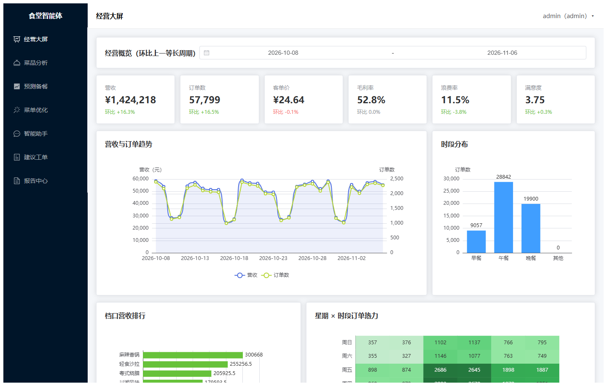
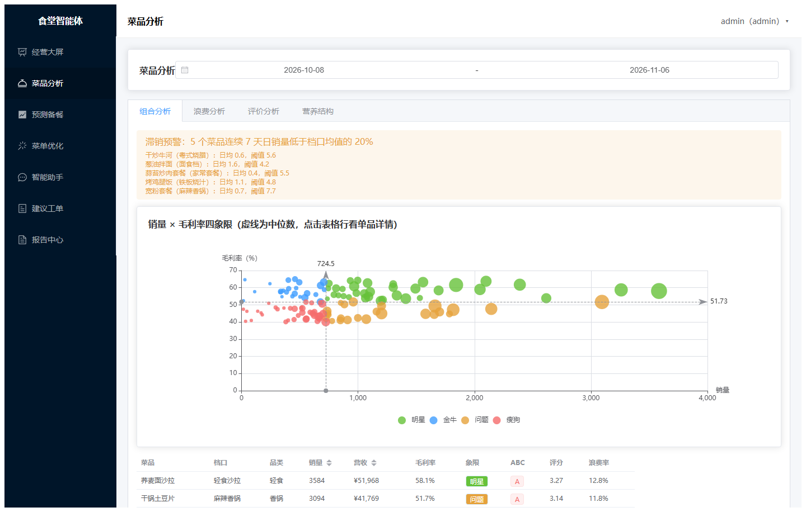
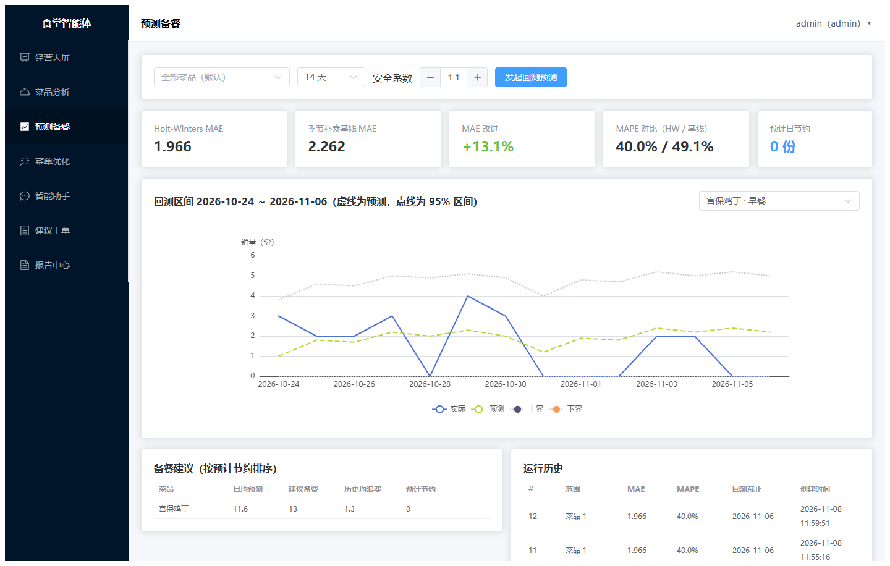
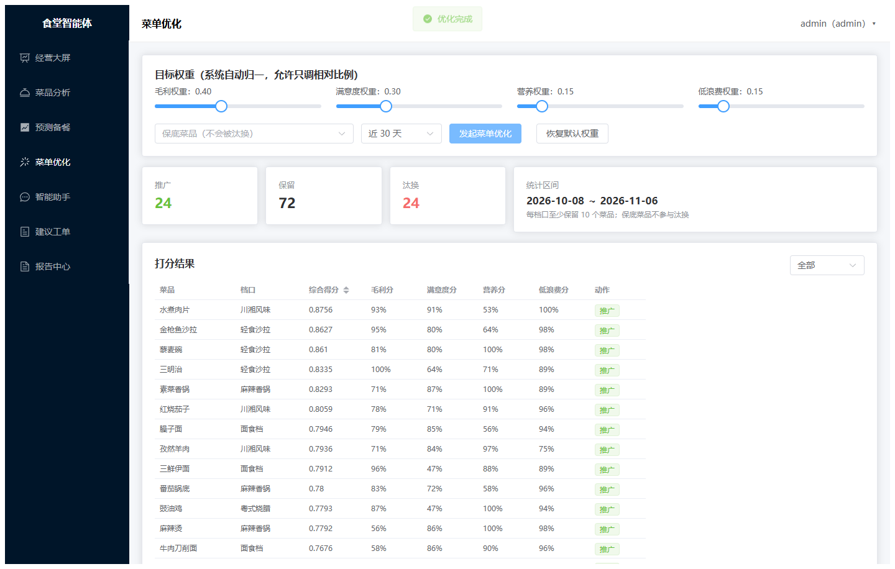
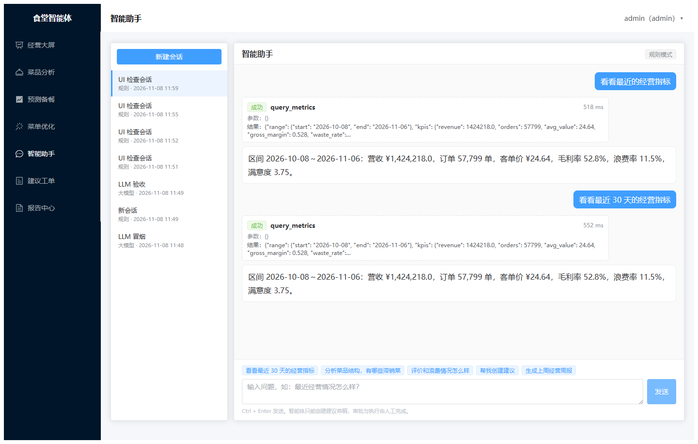
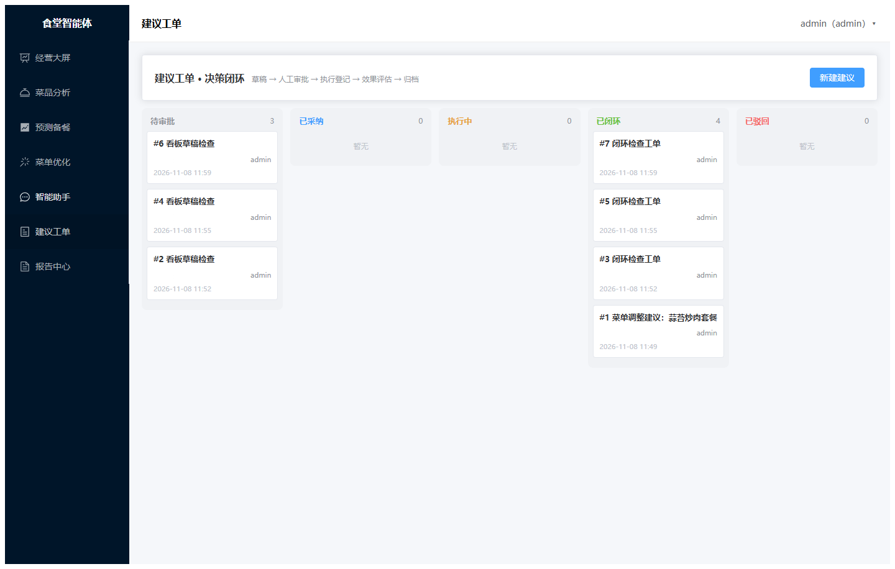
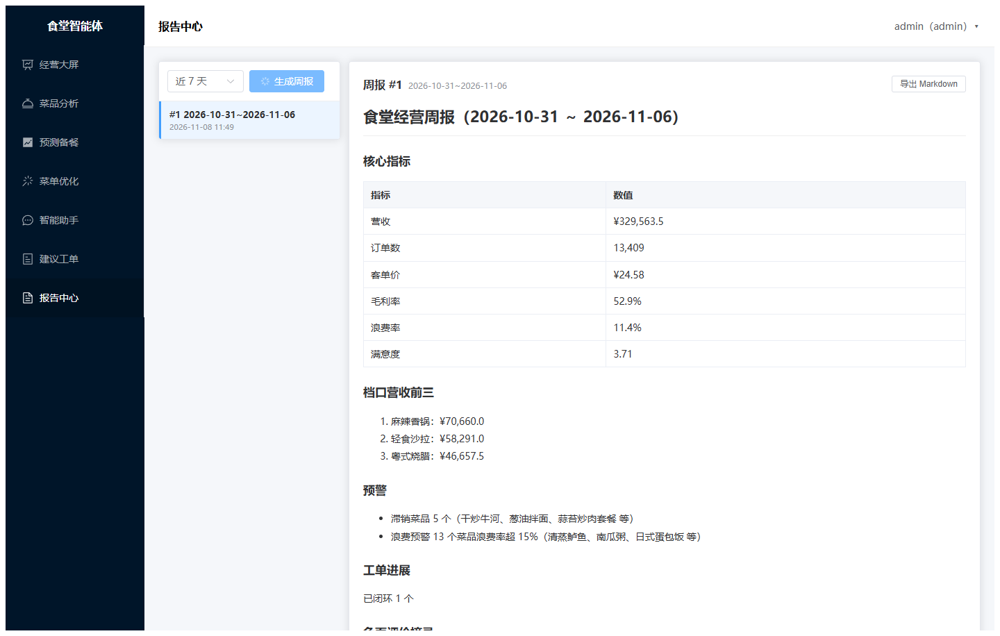
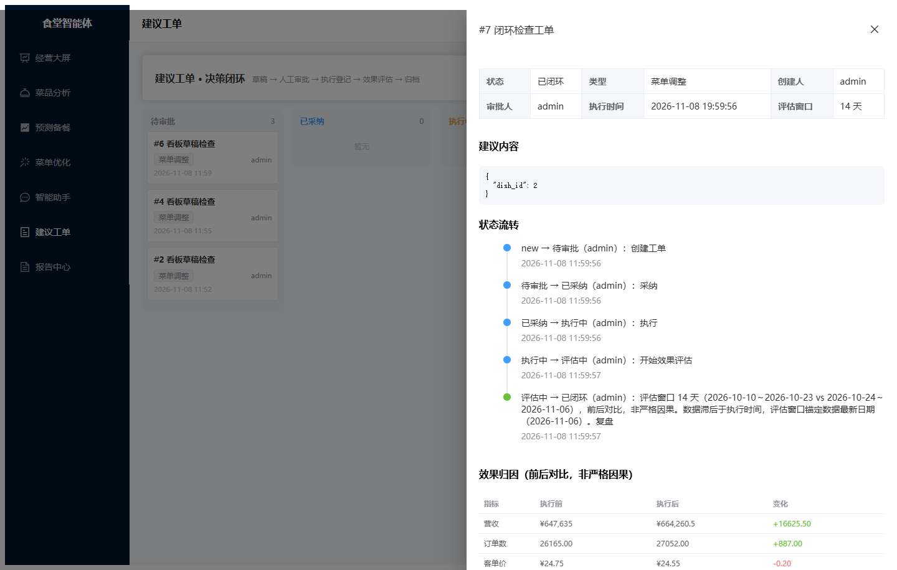

# 校园食堂智能体 canteen-agent

[](https://github.com/GitHubZGJ/canteen-agent/actions/workflows/ci.yml)

面向校园食堂经营的就餐数据分析与菜品优化智能体。覆盖「数据 → 分析 → 建议 → 采纳 → 追踪 → 复盘」决策闭环：智能体调用领域分析工具产出建议工单，经人工审批、执行登记、效果归因后归档。

当前进度：v0.1.0 开源就绪（M1～M6 全部完成）。

## 快速开始

环境要求：Python 3.12+，Windows / Linux / macOS（以下步骤在 Windows 实测）。

```bash
cd canteen-agent/backend
python -m venv .venv
.venv/Scripts/python.exe -m pip install -r requirements-dev.txt
```

把项目根目录的 `.env.example` 复制为 `.env`，填写 `JWT_SECRET`（任意随机串）；大模型三项可留空，系统自动降级为规则模式。

```bash
.venv/Scripts/python.exe scripts/dev.py start         # 启动后端（自动迁移 + 播种演示账号）
.venv/Scripts/python.exe scripts/generate_data.py     # 生成 180 天模拟经营数据
```

启动后访问接口文档：http://127.0.0.1:8000/docs 。

前端（另开终端）：

```bash
cd canteen-agent/frontend
npm install
npm run dev
```

访问 http://localhost:5173 ，用演示账号登录即可看到经营大屏与菜品分析。

或用 Docker 一键启动（前端 8080、后端 8000）：

```bash
cp .env.example .env     # 至少修改 JWT_SECRET
docker compose up -d --build
docker compose exec backend python scripts/generate_data.py
```

更多部署方式见 [部署手册](docs/deployment.md)。

常用命令（均在 `backend` 目录下执行）：

| 命令 | 作用 |
| --- | --- |
| `.venv/Scripts/python.exe scripts/dev.py stop` | 停止后端 |
| `.venv/Scripts/python.exe -m pytest tests -q` | 运行测试 |
| `.venv/Scripts/python.exe scripts/verify_m1.py` | M1 验收检查 |
| `.venv/Scripts/python.exe scripts/generate_data.py --reset` | 清空并重建模拟数据 |
| `.venv/Scripts/python.exe -m ruff check app scripts tests` | 静态检查 |
| `.venv/Scripts/python.exe scripts/verify_m2.py` | M2 验收（API 与 raw SQL 对照） |
| `.venv/Scripts/python.exe scripts/verify_m3.py` | M3 验收（回测达标、优化可复现） |
| `.venv/Scripts/python.exe scripts/verify_m4.py` | M4 验收（智能体、闭环、周报、权限） |
| `.venv/Scripts/python.exe scripts/smoke_llm_agent.py` | 真实大模型冒烟（有 Key 时） |

前端常用命令（在 `frontend` 目录下）：`npm run build` 类型检查与构建；`npm run ui:check` 用本机 Edge 无头跑 UI 验证并截图。

Linux/macOS 把 `.venv/Scripts/python.exe` 换成 `.venv/bin/python` 即可。

## 演示账号

首次启动自动播种，生产部署后请立即改密。

| 账号 | 密码 | 角色 |
| --- | --- | --- |
| admin | Admin@123 | 管理员 |
| manager | Manager@123 | 食堂经理 |
| viewer | Viewer@123 | 只读 |

## 项目结构

```text
backend/    FastAPI + SQLAlchemy 2 + Alembic（路由自动发现、统一响应、JWT）
frontend/   Vue 3 + Vite + TypeScript + Element Plus + ECharts（8 个页面）
data/       本地 SQLite（数据库文件不进仓库）；CSV 模板在 backend/app/data_templates
docs/       中文文档：项目规划、架构设计、部署手册、界面截图
```

## 界面预览

| 经营大屏 | 菜品分析 |
| --- | --- |
|  |  |
| **预测备餐** | **菜单优化** |
|  |  |
| **智能助手** | **建议工单** |
|  |  |
| **报告中心** | **闭环详情** |
|  |  |

## 质量保障

- 后端 pytest 测试：算法手算夹具、接口集成（数字与独立 raw SQL 对照）、工单状态机负向用例（连错误消息一起断言）、智能体规则/大模型/降级路径、CSV 导入校验。
- 四份验收脚本（`verify_m1.py` ～ `verify_m4.py`）在真实数据上检查看板口径、四象限与预警、回测优于基线、闭环全流程。
- 前端 Edge 无头自动化覆盖登录、数据展示、流式对话、工单闭环、报告生成并输出截图。
- CI：ruff、pytest、前端类型检查与构建、gitleaks 密钥扫描（GitHub Actions）。

## 文档

- [项目规划](docs/project-plan.md)：定位、范围、里程碑、开源计划
- [架构设计](docs/architecture.md)：分层、数据库、API、智能体与算法设计
- [部署手册](docs/deployment.md)：本地开发、Docker Compose、环境变量、常见问题
- [贡献指南](CONTRIBUTING.md)：代码约定、提交检查、新增工具步骤

## 数据声明

仓库与演示使用的数据全部为程序模拟生成（固定随机种子，可复现），不含任何真实个人信息。默认规模：2 个食堂、8 个档口、120 个菜品、180 天 259,949 单订单、416,035 条明细、21,091 条评价、21,600 条浪费记录。支持 CSV（逗号分隔值文件）导入脱敏真实数据。

## 开源协议

[MIT](LICENSE)
